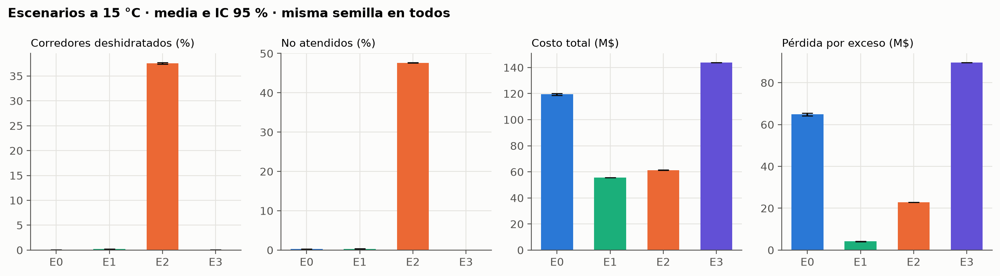
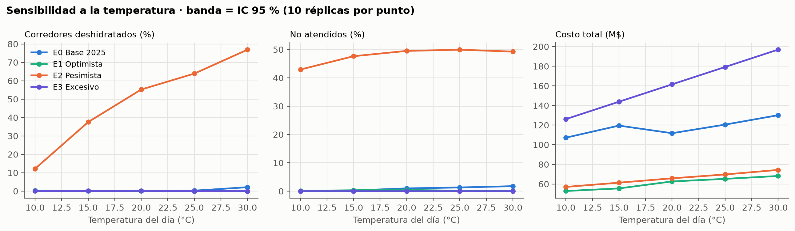

# Informe final y defensa del TPI — guía de trabajo

Base para armar el informe (PDF) y preparar la defensa del 10 y 11 de noviembre. Reúne qué se entrega, qué se evalúa, los escenarios, las distribuciones, las librerías y las preguntas probables. Las secciones marcadas **[completar]** se llenan con los resultados de las corridas.

Documentos relacionados: [Propuesta_Maraton.md](Propuesta_Maraton.md) (lo aprobado), [Registro_Componentes_Modelo.md](Registro_Componentes_Modelo.md) (qué hay en el modelo), [Subfase4_Costos_CostoBeneficio.md](Subfase4_Costos_CostoBeneficio.md) (costos y experimento), [Datos/](Datos/) (datos reales y su análisis).

---

> **Actualización 2026-11-02 (2) — óptimo según el pronóstico.** Con la carrera completa, el Optimista armado para 15 °C dejaba 12,8 % de deshidratados en un día de 20 °C. Ahora se planifica con el pronóstico del día: puestos por la regla de distancia máxima, stock con una tabla de demanda por temperatura (Relevamiento a 10, 15, 20, 25 y 30 °C, 275 corridas), voluntarios que crecen con el calor (×1,52 a 30 °C) y camiones de respaldo que salen solo si el stock no va a alcanzar. Resultado: menos del 0,3 % de deshidratados a todas las temperaturas, con un ahorro de 44 a 54 % frente a la base. Aparte, 60 corridas miden el pronóstico errado (plan de 15 °C en días de 20, 25 y 30 °C).

> **Actualización 2026-11-02 — carrera completa.** La versión PLE corta toda corrida a las 5 h cuando el modelo usa la Pedestrian Library, y con ese corte quedaban afuera los 1.405 corredores más lentos (11 %). Ahora hay dos modelos con la misma lógica: `PuestosDeHidratacionDeUnaMaraton` (con escenas 3D, para la demo, el video y la Cloud; corta a los 300 min) y `PuestosDeHidratacionDeUnaMaraton_CarreraCompleta` (sin Pedestrian Library; cada corrida termina cuando llega el último corredor). Cortados a los 300 min, los dos dan exactamente lo mismo en las 35 métricas (8 corridas comparadas). `Sensibilidad` (400) y `Relevamiento` (55) se volvieron a correr con el segundo, y la tabla de stock del Optimista se recalculó con la carrera completa. Las tablas de esta guía, el informe y la planilla tienen esos números. Los resultados con el corte de 300 min quedaron en `Datos/experimentos/horizonte_300min/`.

> **Actualización 2026-11-01 (noche) — generadores aleatorios y 20 réplicas.** La lógica de la carrera ahora sortea con su propio generador, separado del de la animación 3D y la biblioteca de peatones: abrir una vista ya no cambia el resultado. Se volvieron a correr `Sensibilidad` (ahora con 20 semillas, 400 corridas) y `Relevamiento`; las tablas de esta guía, el informe y la planilla tienen esos números. Los escenarios se llaman Optimista (E1), Pesimista (E2) y Excesivo (E3), como sus experimentos.

> **Actualización 2026-11-01 — decisión de hidratarse.** Antes la probabilidad de parar tenía un término fijo que no dependía de lo recorrido (en el km 5 paraba un tercio de los elite) y se decidía con los datos del puesto anterior (el SelectOutput evalúa la condición antes del onExit del MoveTo). Ahora cada corredor tiene un **intervalo preferido entre tomas** según su categoría (elite U(8; 12) km, avanzado U(5; 8), intermedio U(3,5; 5,5), principiante U(2,5; 4)), basado en Beis et al. 2012 (los elite toman ad libitum, ~25 s en total por maratón) y en la pauta del ACSM de 150–350 mL cada 15–20 min. Las ganas de tomar vuelven de a poco después de cada toma, crecen hasta el doble si no toma y el intervalo se acorta con el calor; la sed por deshidratación sigue sumando. Con esto se repitieron el `Relevamiento` y las 200 corridas de `Sensibilidad`; todos los números de esta guía son los nuevos.

## 1. Qué hay que entregar y qué se evalúa

| Entregable | Detalle | Estado |
|---|---|---|
| Informe final en PDF | Con el análisis de resultados incluido y el link al modelo en AnyLogic Cloud | [completar] |
| Modelo | Archivo del modelo. La cátedra pide **ALP**; el proyecto está en formato `.alpx` (carpeta `_alp/`). Probar con *File → Save As* si AnyLogic permite guardarlo como `.alp`; si no, entregar la carpeta comprimida y aclararlo. `PuestosDeHidratacionDeUnaMaraton.original.alp` es de agosto y está desactualizado. | [completar] |
| AnyLogic Cloud | Subir el modelo desde AnyLogic y pegar el link en el informe. Probar antes que en la nube corra igual (mapa GIS, 3D, controles). | [completar] |
| Defensa presencial | 10 y 11 de noviembre, en horario de clase. Se muestra en vivo el escenario principal y, si se puede, los alternativos. | — |

**Criterios de evaluación:** objetivos, uso de datos reales, análisis de resultados y desarrollo del modelo en AnyLogic. Cada sección de este documento apunta a uno de esos cuatro.

---

## Los 10 pasos del estudio de simulación

El informe se ordena siguiendo los 10 pasos de un estudio de simulación. Para cada paso: qué se hizo y dónde está el detalle.

| Paso | Qué se hizo en este TP | Detalle |
|---|---|---|
| **1. Formulación del problema** | Una maratón masiva tiene que hidratar a ~12.800 corredores con puestos, voluntarios y stock. Si falta algo, hay corredores deshidratados y colas; si sobra, se pierde dinero. La disposición actual se decide por experiencia, sin evaluar alternativas. | Sección 3, [Propuesta](Propuesta_Maraton.md) |
| **2. Objetivos y plan del estudio** | Determinar la cantidad de puestos, voluntarios y stock que cubre lo justo para que ningún corredor se deshidrate, según el clima, al menor costo. Se miden 12 indicadores y se comparan 4 escenarios con intervalos de confianza. | Secciones 3 y 8 |
| **3. Conceptualización del modelo** | Corredor como agente con hidratación y energía que bajan por km. Cada puesto es una cola G/G/c (voluntarios) más un inventario por insumo con reposición (ROP). Logística con camión y zorra. Simulación terminante: de la largada al corte. | Sección 4 |
| **4. Recolección de datos** | Datos reales: 12.795 corredores de 2025 (largada, tiempos cada 5 km), puestos, recorrido GIS y clima del SMN. Bibliografía: ingesta (Sevilla 2022), vaso (Boston 2017), dotación de voluntarios (Vermont City). El resto son supuestos declarados. | Secciones 5 y 6, [Datos/](Datos/) |
| **5. Construcción del modelo** | AnyLogic 8.9 PLE con las librerías Process Modeling, GIS y Pedestrian, 9 tipos de agente y código Java para las decisiones, el inventario, los costos y la exportación de resultados. | Sección 7, [Registro](Registro_Componentes_Modelo.md) |
| **6. Verificación** | Casos de prueba V1–V8 con resultado esperado conocido: un corredor, sin stock, pocos voluntarios, conservación de unidades, costos. | Sección 9.1 |
| **7. Validación** | Contra la carrera real: pico de corredores por minuto en cada puesto (13 de 15 dentro del ±10 %, ±4 min) y tiempo neto de los mismos corredores (simulado/real = 1,001; el último llega a los 403,6 min contra 401,0). | Sección 9.2 |
| **8. Diseño de experimentos** | 4 escenarios (base, óptimo, escasez, exceso) con las mismas semillas 1–20 (números aleatorios comunes). Sensibilidad a la temperatura de 10 a 30 °C. Carrera completa (hasta el último corredor), con la copia sin escenas 3D. IC del 95 %. | Secciones 8 y 10 |
| **9. Corridas y análisis de resultados** | Experimentos `Relevamiento`, `Optimizacion`, `Escenarios` y `Sensibilidad` (Parameter Variation). Medias con IC 95 %, diferencias pareadas contra la base y análisis de sensibilidad. | Sección 10, `Datos/experimentos/` |
| **10. Documentación e implementación** | Informe PDF, modelo en AnyLogic Cloud, recomendación (escenario óptimo) y defensa en vivo. | Secciones 11 y 14 |

---

## 2. Calibración con los datos reales (hecha el 27/10/2026)

Revisando el modelo contra los datos reales aparecieron dos huecos que la cátedra podía marcar. Ya están resueltos en el modelo.

### 2.1 La largada ahora es la real

**Antes**, el `Source` generaba un corredor cada `exponential(0,5)` segundos (Poisson, 30 por minuto) hasta 15.000, así que la largada duraba más de 8 horas. En la carrera real:

- Largaron 12.795 corredores y el 95 % cruzó la alfombra en los primeros **4,8 minutos** ([fig. 2](Datos/figuras/fig2_cruce_largada.png)).
- Por el km 5 pasaron hasta **1.235 corredores por minuto** ([fig. 3](Datos/figuras/fig3_flujo_por_punto.png)).

El modelo viejo le mandaba a cada puesto unos 30 por minuto, parejos, y además corría más rápido que la realidad ([fig. 4](Datos/figuras/fig4_ritmo_categorias.png)).

**Ahora**, cada corredor simulado es un corredor real de 2025 (los 12.792 que llegaron): cruza la largada en el segundo en que la cruzó, y su ritmo base sale de su tiempo neto oficial. Se conserva la relación real entre orden de largada y ritmo (Spearman 0,48).

- **Categoría:** sale de ese tiempo con los cortes reales 3 / 17 / 50 / 30 %.
- **Modificadores:** calor, deshidratación, "muro" y fatiga siguen actuando sobre el ritmo. `ajusteRitmo` = 1,039 compensa su efecto medio, calibrado para que simulado / real = 1,000 (con la carrera completa da 1,001).
- **Otros escenarios:** con otra cantidad de corredores se usa bootstrap, es decir, se sortean corredores reales con reposición.
- **Voluntarios por puesto:** 10 a 35 (Vermont City Marathon), proporcionales al pico real de cada puesto: 35 en el km 5, 10 en el km 40.
- **Stock inicial:** según la demanda esperada. Da ~1,6 vasos por corredor en el km 5, el mismo orden que Boston 2017.
- **Temperatura base:** 15 °C (SMN).

### 2.2 Ahora se mide el tiempo de espera

Cuando el corredor decide parar se guarda la hora. Al terminar la atención:

> espera = tiempo transcurrido − tiempo de atención

Por puesto se calculan la media, el máximo y el percentil 95. Se ven en la sección "Validación" de Métricas y se exportan a CSV.

Detalle técnico en [Registro_Componentes_Modelo.md](Registro_Componentes_Modelo.md), sección "Calibración con la carrera real 2025".

---

## 3. Objetivos

**Objetivo general.** Evaluar, con un modelo de simulación de eventos discretos y agentes construido con datos reales de la Maratón de Buenos Aires 2025, distintas configuraciones de puestos de hidratación (voluntarios, forma de entrega, stock y logística de reposición). El fin es encontrar la que dé el mejor nivel de servicio al menor costo.

**Objetivos específicos y cómo se miden:**

| # | Objetivo | Indicador (KPI) | Dónde se ve |
|---|---|---|---|
| O0 | Que ningún corredor se deshidrate | % de corredores que bajan del umbral de hidratación (0,7) y % de casos severos (< 0,5) | Sección "Validación" de Métricas y `resultados_corridas.csv` |
| O1 | Minimizar el tiempo de espera en los puestos | Espera media y P95 por puesto (s) | Sección "Validación" de Métricas y `resultados_puestos.csv` |
| O2 | Reducir el riesgo de faltantes | Corredores no atendidos por falta de stock; minutos con stock en cero; reposiciones | Métricas: inventario, `noAtendidosStock` |
| O3 | Asegurar la atención | % de corredores que quisieron parar y no fueron atendidos (stock + cola) | `porcentajeNoAtendidos()` |
| O4 | Optimizar los costos | Costo total, costo por corredor atendido y valor del sobrante | Sección "Costos del evento" |
| O5 | Dimensionar la logística | Camiones despachados, horas de camión y operario, demora de reposición | Métricas y resumen de inventario |

**Preguntas que responde el estudio:**

1. ¿Cuántos voluntarios por puesto hacen falta para que casi nadie se quede sin atender?
2. ¿Conviene que el voluntario entregue en mano o que el corredor se sirva de la mesa?
3. ¿El stock inicial y la política de reposición alcanzan si el día es caluroso?
4. ¿Cuánto cuesta cada configuración y cuál está en la frontera costo-servicio?

---

## 4. El sistema y el modelo, en simple

**El sistema real:** unos 12.800 corredores recorren 42,195 km y pasan por 15 puestos. En cada puesto unos voluntarios entregan agua, isotónica, fruta o gel. Cuando un insumo baja de cierto nivel, sale un camión del depósito, estaciona cerca y un operario lleva la mercadería con una zorra hasta la mesa.

**Cómo se representa:**

| Elemento real | En el modelo | Tipo |
|---|---|---|
| Corredor | Agente `Corredor`: categoría, velocidad, hidratación y energía que cambian con los km | Entidad (agente) |
| Puesto | Agente `Puesto`: stock por insumo, punto de reposición, contadores; y en `Main` un `SelectOutput → Seize → Delay → Release` por puesto | Cola + inventario |
| Voluntarios | `ResourcePool` por puesto; 10 a 35 según el flujo real del puesto (`voluntariosIniciales`) | Servidores (c) |
| Recorrido | `MoveTo` sobre el mapa GIS real entre puestos | Desplazamiento |
| Camión | Agente `Camion`: va por calles reales (ruteo GIS) del depósito al puesto | Logística |
| Operario con zorra | Agente `OperarioZorra`: hace viajes de carga | Logística |
| Clima | Parámetro `temperaturaC`, convertido a `nivelCalor` (0 a 1) | Factor del escenario |

**Cola de cada puesto.** La propuesta la plantea como M/M/c. En la implementación:

- Las llegadas al puesto **no son Poisson estacionarias**: salen del movimiento de los corredores, y forman la ola de la fig. 3.
- El tiempo de servicio es **uniforme** (3–9 s), no exponencial, porque es un tiempo acotado: extender un vaso no puede durar 0 s ni 2 min.

Formalmente es una cola **G/G/c** con llegadas no homogéneas. El M/M/c sirve como referencia teórica, pero no se usan sus fórmulas cerradas. Por eso se simula.

**Inventario de cada puesto.** Es de revisión continua con punto de reposición ROP = d·L + z·√(d·L): demanda durante el tiempo de entrega más un stock de seguridad, suponiendo demanda Poisson y nivel de servicio del 95 % (z = 1,65).

**Tipo de simulación.** Es **terminante**: la carrera empieza vacía con el disparo y termina cuando llega el último corredor. No hay período de calentamiento. Cada réplica es una carrera completa.

---

## 5. Datos: reales, bibliográficos y supuestos

Conviene presentarlos así, separados, porque la cátedra evalúa el uso de datos reales y valora la honestidad sobre lo que es supuesto.

| Dato | Valor | Tipo | Fuente |
|---|---|---|---|
| Corredores, tiempos de paso cada 5 km, cruce de largada, tiempo final | 12.795 corredores (8.897 H / 3.898 M) | **Real** | Resultados oficiales raceresult, evento 361890 ([Datos/](Datos/)) |
| Ubicación y oferta de los puestos | 15 puestos, km y tipo de insumo | **Real** | Mapa oficial del circuito y shapefile `puestos_hidratacion3` |
| Recorrido | Trazado GIS del circuito 2025 | **Real** | GPX del circuito pasado a shapefile |
| Clima del día | 12–15 °C en la largada, máxima 18 °C | **Real** (pronóstico SMN) | [Canal 26, 20/9/2025](https://www.canal26.com/general/2025/09/20/cambia-el-clima-para-la-maraton-internacional-de-buenos-aires-como-puede-afectar-el-viento-a-los-participantes/) |
| Tiempo máximo de carrera | 6 h (7 a 13 h) | **Real** | Organización, vía prensa |
| Ingesta de líquido | 466 ± 279 mL/h | Bibliografía | Jiménez-Alfageme et al. (2025), Sports Med Open 11:26 |
| Volumen por vaso | 116 mL | Bibliografía | Cheuvront et al. (2019), Med Sci Sports Exerc 51(5) — Boston 2017 |
| Nivel de servicio del inventario | z = 1,65 (95 %) | Bibliografía | Modelo clásico de revisión continua |
| Largada y ritmo de cada corredor | Los 12.792 que llegaron: segundo de cruce y tiempo neto | **Real** | Se repiten tal cual en la simulación (sección 2.1) |
| Cortes de categoría | 175,0 / 210,9 / 264,7 min (3 / 17 / 50 / 30 %) | **Real** (cuantiles) | Tiempos netos 2025 |
| Flujo por puesto | Pico, minuto del pico y flujo medio de los 15 puestos | **Real** | Splits interpolados al km de cada puesto (`Datos/datos_modelo_puestos.txt`) |
| Voluntarios por puesto | 10 a 35, más en los primeros | Bibliografía | Guía de voluntarios de Vermont City Marathon; repartido según el pico real |
| Stock inicial | Demanda esperada (~1,6 vasos por corredor en el km 5) | Bibliografía | Mismo orden que Boston 2017 (43.000 vasos por puesto para 27.222 corredores) |
| Cadencia y zancada por categoría | Normales por categoría | Supuesto | Solo reparten la velocidad real en pasos (animación); no cambian el ritmo |
| Gel y fruta por corredor | 0,5 y 0,4 | Supuesto | Sin bibliografía de retiro por puesto |
| Tiempo de entrega del vaso | 3–9 s | Supuesto razonado | Layout de puestos (mvpvisuals) |
| Precios y tarifas | Valores de ejemplo | Supuesto | Se cargan en el panel "Precios y tarifas" |
| Ajuste de ritmo | 1,039 | **Calibrado** | Para que tiempo simulado / real = 1,000 |

**Por qué no hay más datos reales de la organización:** no se consiguió contacto con los organizadores. Lo que no se pudo medir se tomó de bibliografía publicada sobre maratones masivas (Boston, Sevilla) o quedó como parámetro. Los parámetros supuestos se tratan como **factores del experimento**: en vez de fijar un valor dudoso, se muestra cómo cambia el resultado al variarlo.

---

## 6. Distribuciones utilizadas

Explicación corta para la defensa:

- **Exponencial:** tiempo entre eventos independientes que ocurren a tasa constante (proceso de Poisson).
- **Uniforme(a, b):** cuando solo se conoce un rango y no hay razón para preferir un valor dentro de él.
- **Normal:** magnitudes biológicas que se agrupan alrededor de una media (cadencia, zancada).
- **Bernoulli:** decisiones sí/no con una probabilidad (parar o no, qué bebida tomar).
- **Empírica:** se muestrea directamente de los datos reales, sin suponer una forma.

### 6.1 En el modelo actual

| Elemento | Variable | Distribución | Parámetros | Justificación |
|---|---|---|---|---|
| Llegada de corredores | Segundo de cruce de la largada | **Empírica real (traza)** | Los 12.792 corredores reales, en su orden; con otra cantidad, bootstrap | Reproduce la carrera 2025 (simulación conducida por traza) |
| Ritmo base | por corredor | **Empírica real** | tiempo neto oficial / 42,195 km × 1,039 | El ritmo de ese corredor real |
| Categoría del corredor | Elite / Avanzado / Intermedio / Principiante | Derivada | Por el tiempo real: < 175,0 / < 210,9 / < 264,7 / resto | Da 3 / 17 / 50 / 30 % en los datos |
| Cadencia (pasos/min) | por categoría | Normal truncada abajo | E: N(185; 4) ≥175 · A: N(178; 5) ≥165 · I: N(170; 6) ≥155 · P: N(160; 7) ≥145 | Variación biológica alrededor de una media por nivel |
| Zancada (m) | por categoría | Normal truncada abajo | E: N(1,72; 0,06) · A: N(1,32; 0,07) · I: N(1,12; 0,07) · P: N(0,95; 0,07) | Ídem; la zancada se ajusta para que cadencia × zancada = velocidad real |
| Tolerancia al calor | por categoría | Uniforme | E: U(1,1; 1,4) · A: U(0,95; 1,25) · I: U(0,8; 1,2) · P: U(0,7; 1,1) | Solo se conoce un rango relativo |
| Propensión a hidratarse | por categoría | Uniforme | E: U(0,15; 0,30) · A: U(0,20; 0,35) · I: U(0,25; 0,40) · P: U(0,35; 0,55) | Rango plausible; los principiantes paran más |
| Tiempo de atención | por corredor | Uniforme × factor | U(0,05; 0,15) min × factor de categoría (0,5 a 1,4), × 0,5 con entrega en mano | Entrega de un vaso: tiempo acotado de 3–9 s |
| Decisión de parar en un puesto | sí/no | Bernoulli(p) | p = [(propensión + calor) × hábito + 1,2 × (1 − hidratación)] × necesidad / tolerancia, acotada a [0, 1]; hábito = km desde la última toma / intervalo preferido (hasta 2; el intervalo se acorta hasta la mitad con calor) | Decisión individual que depende del estado del corredor |
| Bebida elegida | isotónica o agua | Bernoulli | 0,7 (elite/avanzado) o 0,4 (resto) | Supuesto de preferencia |
| Toma fruta | sí/no | Bernoulli | 0,7 (intermedio/principiante) o 0,3 | Supuesto de preferencia |
| Demanda para el ROP | unidades durante el tiempo de entrega | Poisson (supuesta) | media d·L, varianza d·L | Da el stock de seguridad z·√(d·L) |
| Camión y zorra | velocidades y descarga | Determinísticas | 25 km/h por calles reales, 3,5 km/h, 1 min | El ruteo GIS ya aporta la variación por distancia |

Solo afectan la animación 3D y no los resultados: colores y ropa (`uniform_discr`), caminata de voluntarios (U(1,5; 3) s) y peatones (U(1,1; 1,5) m/s).

### 6.2 Ajuste de distribuciones a los datos reales

| Variable real | Mejor ajuste | Bondad de ajuste | Uso en el modelo |
|---|---|---|---|
| Tiempo neto de carrera | **Lognormal** (σ = 0,144; desplazamiento −40,5; escala 283,4) — media 245,8 min, desvío 41,4 | KS D = 0,011, **p = 0,073**: no se rechaza al 5 %. Normal: p ≈ 0, se rechaza | Se usa la empírica (cada corredor real); la lognormal sirve para explicar la forma y para generar corredores si se quisiera |
| Cruce de la largada | **Empírica**. La exponencial (media 1,43 min) es la más cercana, KS D = 0,076, pero se rechaza | Con n = 12.792 cualquier diferencia chica es significativa | Se usa la empírica: el segundo real de cada corredor |
| Desaceleración (ritmo 2.ª mitad / 1.ª mitad) | Mediana 1,05; principiantes 1,12 | Descriptivo | Referencia para validar la fatiga |

Gráficos: [tiempo de llegada con la lognormal](Datos/figuras/fig1_tiempo_llegada.png), [cruce de largada](Datos/figuras/fig2_cruce_largada.png), [flujo por punto](Datos/figuras/fig3_flujo_por_punto.png), [ritmo por categoría](Datos/figuras/fig4_ritmo_categorias.png). Resultados completos en [Datos/resultados_analisis.txt](Datos/resultados_analisis.txt).

**Si preguntan por qué KS rechaza casi todo:** con miles de datos, el test detecta diferencias minúsculas que no importan en la práctica. Por eso, además del p-valor, se mira el gráfico y el estadístico D (la máxima distancia entre la acumulada real y la teórica). Para el cruce de largada se usa directamente la distribución empírica.

---

## 7. Librerías y herramientas de AnyLogic usadas

| Librería / herramienta | Elementos | Para qué |
|---|---|---|
| **Process Modeling Library** | `Source` (1), `MoveTo` (16), `SelectOutput` (15), `Seize` (15), `Delay` (15), `Release` (15), `ResourcePool` (15), `Sink` (1) | El flujo de cada corredor: largada → tramo → ¿para? → tomar voluntario → atención → liberar → siguiente tramo → llegada |
| **GIS (Space Markup)** | `GISMap`, 15 `GISPoint`, ruteo por calles | Mapa real de Buenos Aires, recorrido del circuito y camino del camión por calles reales |
| **Pedestrian Library** | `PedSource`, `PedSelectOutput`, `PedGoTo` (2), `PedWait`, `PedSink`, `TargetLine`, `RectangleNode` | Escena 3D de un puesto: corredores que pasan, frenan y toman el vaso |
| **Agentes** | `Main`, `Corredor`, `Puesto`, `Camion`, `OperarioZorra`, `PuestoDetalle3D`, `Voluntario`, `peatonPuesto`, `Transeunte` (9 de los 10 tipos que permite PLE) | Cada entidad con su estado y comportamiento |
| **Eventos** | Evento dinámico `MedirDemanda` (cada minuto) | Integra la demanda observada y las horas-voluntario |
| **Analysis** | 6 `TimePlot` (stock de cada insumo, costos y flujo por puesto), datasets | Gráficos en vivo |
| **Controls** | `Slider` (5), `EditBox` (11), botones como formas con *On click* | Cambiar parámetros durante la corrida |
| **3D** | `Window3D`, `Camera3D` (4), objetos 3D (edificios, árboles, mesas, personas) | Vista 3D de los puestos |
| **Navegación** | 4 `Area` (View Areas) + función `irA()` | Menú con pantallas |
| **Java** | Funciones propias (largada real, decisión, atención, espera, ROP, costos, validación, exportación a CSV) | Lógica que los bloques no traen hecha |

**Límites de la versión PLE que hay que conocer:** como máximo 10 tipos de agente (se usan 9), y **5 horas de simulación** cuando el modelo usa la Pedestrian Library. Según la página de ediciones de AnyLogic, el límite de 5 h rige para todas las librerías salvo la Process Modeling Library; de las que usa este modelo, solo afecta a la Pedestrian (el GIS es parte del motor). Con los datos reales el 89 % termina antes de los 300 min y el último llega a los 401 min. Por eso los experimentos se corren con la copia sin escenas 3D (`PuestosDeHidratacionDeUnaMaraton_CarreraCompleta`), que llega hasta el último corredor, y el modelo con 3D queda para mostrar.

---

## 8. Escenarios y métricas

### 8.1 Escenarios

Se eligen con el parámetro `escenario` de `Main`. Todos usan los mismos 12.792 corredores reales, simulan la carrera completa (hasta el último corredor) y se corren con las **mismas semillas 1 a 20** (parámetro `semilla`). Así, la única diferencia entre escenarios es la configuración.

| Escenario | `escenario` | Qué representa | Configuración |
|---|---|---|---|
| **E0 — Base 2025** (principal) | 0 | La carrera tal como se organizó | 15 puestos reales; 10–35 voluntarios por puesto según el flujo real; stock según la demanda fisiológica (~1,6 vasos por corredor en el km 5, como Boston); reposición con camión |
| **E1 — Optimista (óptimo según el clima)** | 1 | Lo justo para que nadie se deshidrate, al menor costo | Puestos elegidos por la regla de distancia máxima según la temperatura pronosticada (9 a 10 °C, 12 a 15 °C, 15 desde 20 °C); stock = demanda observada + 1,65 desvíos (cubre el 95 % de las carreras), con una tabla por temperatura; voluntarios ×1 hasta 15 °C y hasta ×1,52 a 30 °C; camiones de respaldo que salen solo si el stock no va a alcanzar hasta el último corredor |
| **E2 — Pesimista (escasez)** | 2 | Recursos que no alcanzan: congestión | 15 puestos, ¼ de los voluntarios y 35 % del stock |
| **E3 — Excesivo (exceso de recursos)** | 3 | Recursos de sobra: cuánto se pierde | 15 puestos, el doble de voluntarios y el doble de stock |
| Relevamiento (auxiliar) | 4 | Medir cuánto se retira realmente | Plan del óptimo con stock de sobra y sin camiones, a 10, 15, 20, 25 y 30 °C; sirve para calibrar E1 |

**Cómo se llegó al óptimo (E1):**

1. **Distancia máxima entre puestos con bebida** = C / pérdida de hidratación por km del corredor más exigente (principiante) a la temperatura pronosticada. En teoría C = (1 − 0,7)/2 = 0,15: el margen hasta el umbral de deshidratación, por si se saltea un puesto.
2. **Se recorre el circuito con los 15 puestos reales:** se mantienen los que dan gel o fruta y, cada vez que un tramo supera la distancia máxima, se agrega el puesto más lejano alcanzable.
3. **C se calibró por simulación** (experimento `Relevamiento`, 5 semillas por plan):

   | Puestos | 9 (C = 0,15) | 12 | 14 | 15 |
   |---|---|---|---|---|
   | Deshidratados | 1,8 % | **0,24 %** | 0,14 % | 0,10 % |

   (Experimento `Relevamiento` del 2026-11-02, carrera completa: C de 0,090 a 0,150 cada 0,006, 5 semillas y 5 temperaturas, 275 corridas.)

   El plan de 12 puestos es el de menos puestos con menos del 1 % de deshidratados a 15 °C, así que se fija C = 0,114. Se dejan de armar los puestos de los km 25, 35 y 40. Con ese C la regla da 9 puestos a 10 °C (0,22 % de deshidratados) y los 15 desde 20 °C (0,15 % a 20 °C, 0,27 % a 25 °C). A 30 °C, aun con stock de sobra, da 2,1 %: el límite son los voluntarios (1,7 % de no atendidos en los primeros puestos).
4. **Stock justo:** la demanda por corredor de cada puesto e insumo (lo retirado más lo que habrían tomado los que no fueron atendidos) es muy estable entre semillas. Se coloca media + 1,65 desvíos, con una tabla por temperatura planificada (`Main.retiroPlanificado`, la más cercana a `temperaturaPlan()`).
5. **Voluntarios:** la dotación según el flujo, solo en los puestos armados, multiplicada por cuánto crecen los corredores que paran con el calor: ×1,20 a 20 °C, ×1,38 a 25 °C y ×1,52 a 30 °C (`Main.factorVoluntariosEfectivo`).
6. **Camiones de respaldo:** el stock se coloca antes de la largada. Si, con el retiro medido en el puesto, el stock no va a alcanzar hasta el último corredor, sale un camión que lleva lo que falta más un stock de seguridad (`Puesto.revisarReposicion`, `faltaRespaldo`). A 15 °C salen unos 4 viajes en toda la carrera.
7. **`temperaturaPlanificada`:** con −1 el pronóstico acierta y se planifica con `temperaturaC` (así se corre la Sensibilidad); con un valor fijo se simula un pronóstico errado.

### 8.2 Métricas para validar y comparar

| Métrica | Mide | Mejor si |
|---|---|---|
| % corredores deshidratados (hidratación mínima < 0,7) | Salud: objetivo principal | Menor |
| % deshidratación severa (< 0,5) | Salud, casos graves | Menor |
| % no atendidos (sin stock o sin voluntario libre) | Servicio | Menor |
| Espera media y P95 en cola (s) | Congestión | Menor |
| Unidades faltantes | Quiebre de stock | Menor |
| Ocupación de voluntarios (%) | Uso del personal | Mayor (sin cola) |
| Tiempo neto medio (min) | Rendimiento del corredor | Menor |
| Costo total y costo por atendido ($) | Economía | Menor |
| Valor del sobrante ($) | Insumos comprados y no usados | Menor |
| Pérdida por exceso ($) | Sobrante + horas-voluntario ociosas × tarifa | Menor |

Para validar se usan además las métricas de la sección 9.2: flujo por puesto y tiempo neto contra la carrera real.

## 9. Verificación y validación

### 9.1 Casos de prueba de verificación

**No son escenarios.** Son pruebas para comprobar que el modelo hace lo que se programó, cada una con un resultado esperado conocido.

| Caso | Configuración | Resultado esperado |
|---|---|---|
| V1 — Un solo corredor | 1 corredor | Recorre los 42,195 km, pasa por los 15 puestos en orden y su tiempo es ≈ 42,195 × ritmo |
| V2 — Sin calor ni sed | `temperaturaC` = 10, propensión 0 | Casi nadie para; stock casi intacto |
| V3 — Todos paran | Forzar p = 1 | Atendidos ≈ corredores × puestos (menos los no atendidos) |
| V4 — Sin stock | Capacidad de agua = 0 en un puesto de agua | Todos los que paran ahí quedan como no atendidos por stock y sale un camión enseguida |
| V5 — Pocos voluntarios | `factorVoluntarios` = 0,2 (2 a 7 por puesto) | Aparecen cola y no atendidos por voluntario. **Probado el 27/10, con la decisión de hidratarse anterior:** 58 % de no atendidos, espera media 2 s, máxima 6 s. Con la decisión actual, E2 (¼ de la dotación y 35 % del stock) da 48 % de no atendidos. Base E0: 0,002 % |
| V6 — Conservación | Cualquier corrida | Largados = llegados + en carrera; comprados = consumidos + sobrante (por insumo) |
| V7 — Reposición | Bajar a mano el stock bajo el ROP | Sale un camión, llega en ≈ L minutos, el operario hace ⌈faltante / capacidadZorra⌉ viajes |
| V8 — Costos | Precios en 0 salvo el vaso = 1 | Costo total = vasos comprados |

Para el informe alcanza una tabla con el resultado obtenido de cada caso y un "OK".

### 9.2 Validación contra los datos reales

Se comparó la salida del escenario E0 con la carrera real (media de las semillas 1 a 20 a 15 °C del experimento `Sensibilidad` del 2/11/2026 con la carrera completa, `ajusteRitmo` = 1,039). La misma comparación se ve en vivo en la sección "Validación" de la pantalla de Métricas.

| Puesto (km) | Pico real (corredores/min, minuto) | Pico simulado | Diferencia |
|---|---|---|---|
| 1 (km 5) | 1.235 (min 28) | 1.148 (min 28) | −7 %, mismo minuto |
| 3 (km 10) | 627 (min 55) | 627 (min 55) | 0,0 %, mismo minuto |
| 7 (km 20) | 391 (min 111) | 320 (min 111) | −18 %, mismo minuto |
| 11 (km 30) | 248 (min 168) | 224 (min 164) | −9,7 %, 4 min antes |
| 15 (km 40) | 165 (min 223) | 168 (min 227) | +2 %, 4 min después |

| Indicador | Real 2025 | Simulado E0 |
|---|---|---|
| Tiempo neto de los 12.792 corredores | 245,8 min | 246,2 min (simulado / real = 1,001) |
| Última llegada, desde la largada | 401,0 min | 403,6 min (entre 401,7 y 405,4) |
| Ritmo 2.ª mitad / 1.ª mitad (mediana) | 1,05 | [completar con una corrida] |

**Lectura.**

- El modelo reproduce cuándo llega la ola de corredores a cada puesto, con ±4 min de diferencia.
- Reproduce cuántos pasan por minuto: queda dentro del ±10 % en 13 de 15 puestos (km 20: −18 %, km 22,6: −10,4 %).
- Reproduce el tiempo de carrera de los mismos corredores y la hora en que llega el último.

En general el pico simulado queda 5–9 % por debajo del real, porque la ola simulada sale un poco más pareja. El km 20 (−18 %) es un caso aparte: en los datos reales ese minuto tiene un salto aislado (368, con los minutos vecinos entre 265 y 310). Con esto se puede afirmar que el modelo **reproduce la carrera real**, que es la condición para confiar en los escenarios alternativos.

---

## 10. Diseño experimental, resultados y análisis de sensibilidad

### 10.1 Diseño

- **Simulación terminante:** desde el disparo hasta que llega el último corredor (unos 400 min a 15 °C; hasta 545 min con calor y stock corto), sin período de calentamiento. Se corre con la copia sin escenas 3D, que no tiene el límite de 5 h.
- **Réplicas:** 20 por punto del diseño, con las semillas 1 a 20 (ver 10.4). La semilla se fija al arrancar con `getDefaultRandomGenerator().setSeed(semilla)`, así que cada escenario se corre con los **mismos números aleatorios** (números aleatorios comunes). La lógica de la carrera sortea con un generador propio, separado del de la animación 3D y la biblioteca de peatones: la misma semilla repite el resultado exacto aunque se abra la vista 3D (comprobado).
- **Intervalos de confianza:** IC del 95 % con t de Student (19 grados de libertad): media ± t₀,₉₇₅;₁₉ · s / √20.
- **Comparación:** diferencia pareada por semilla contra E0. La diferencia es significativa si su IC no contiene el 0.
- **Experimento `Sensibilidad`** (Parameter Variation): escenario 0–3 × semilla 1–20 × temperatura 10, 15, 20, 25 y 30 °C, 400 corridas. Se analiza con `Datos/analizar_experimentos.py`.

### 10.2 Escenarios a 15 °C (temperatura del día de la carrera)

| Métrica | E0 Base 2025 | E1 Optimista | E2 Pesimista | E3 Excesivo |
|---|---|---|---|---|
| Corredores deshidratados (%) | 0,08 ± 0,01 | 0,20 ± 0,01 | 37,54 ± 0,17 | 0,09 ± 0,01 |
| Deshidratación severa (%) | 0,00 ± 0,00 | 0,00 ± 0,00 | 6,74 ± 0,10 | 0,00 ± 0,00 |
| No atendidos (%) | 0,25 ± 0,01 | 0,31 ± 0,01 | 47,64 ± 0,06 | 0,00 ± 0,00 |
| Espera media en cola (s) | 0,09 ± 0,00 | 0,11 ± 0,00 | 1,88 ± 0,00 | 0,00 ± 0,00 |
| Espera P95 (puesto más exigido) (s) | 3,0 ± 0,0 | 3,0 ± 0,0 | 5,0 ± 0,1 | 0,0 ± 0,0 |
| Unidades faltantes (u) | 0 ± 0 | 29 ± 13 | 171 ± 9 | 0 ± 0 |
| Ocupación de voluntarios (%) | 14,6 ± 0,0 | 16,3 ± 0,0 | 34,7 ± 0,0 | 7,4 ± 0,0 |
| Tiempo neto medio (min) | 246,2 ± 0,0 | 246,1 ± 0,0 | 247,7 ± 0,0 | 246,2 ± 0,0 |
| Costo total (M$) | 119,51 ± 0,72 | 55,51 ± 0,03 | 61,35 ± 0,08 | 143,83 ± 0,00 |
| Costo por corredor atendido ($) | 988 ± 6 | 532 ± 0 | 811 ± 1 | 1.187 ± 1 |
| Valor del sobrante (M$) | 63,47 ± 0,70 | 3,05 ± 0,05 | 22,59 ± 0,04 | 86,75 ± 0,04 |
| Pérdida por exceso (M$) | 64,83 ± 0,70 | 4,11 ± 0,05 | 22,88 ± 0,04 | 89,61 ± 0,04 |

### 10.3 Diferencias contra la base (misma semilla)

| Métrica | E1 Optimista − E0 | E2 Pesimista − E0 | E3 Excesivo − E0 |
|---|---|---|---|
| Corredores deshidratados (%) | 0,13 ± 0,01 * | 37,46 ± 0,17 * | 0,01 ± 0,01 (ns) |
| Deshidratación severa (%) | 0,00 ± 0,00 (ns) | 6,74 ± 0,10 * | 0,00 ± 0,00 (ns) |
| No atendidos (%) | 0,06 ± 0,01 * | 47,39 ± 0,05 * | -0,25 ± 0,01 * |
| Espera media en cola (s) | 0,02 ± 0,00 * | 1,79 ± 0,00 * | -0,09 ± 0,00 * |
| Espera P95 (puesto más exigido) (s) | 0,0 ± 0,0 (ns) | 1,9 ± 0,1 * | -3,0 ± 0,0 * |
| Unidades faltantes (u) | 29 ± 13 * | 171 ± 9 * | 0 ± 0 (ns) |
| Ocupación de voluntarios (%) | 1,7 ± 0,0 * | 20,1 ± 0,0 * | -7,2 ± 0,0 * |
| Tiempo neto medio (min) | -0,1 ± 0,0 * | 1,6 ± 0,0 * | -0,0 ± 0,0 * |
| Costo total (M$) | -63,99 ± 0,71 * | -58,16 ± 0,71 * | 24,32 ± 0,72 * |
| Costo por corredor atendido ($) | -457 ± 6 * | -178 ± 6 * | 199 ± 6 * |
| Valor del sobrante (M$) | -60,42 ± 0,69 * | -40,88 ± 0,71 * | 23,28 ± 0,70 * |
| Pérdida por exceso (M$) | -60,72 ± 0,69 * | -41,95 ± 0,71 * | 24,78 ± 0,70 * |

\* significativa al 5 %; (ns) no significativa.

**Lectura de los resultados:**

- **E1 Optimista vs. E0:**
  - cuesta **$ 64 M menos (−54 %)** y pierde $ 61 M menos por exceso;
  - usa 12 puestos en vez de 15;
  - la deshidratación sube de 0,08 % a 0,20 %, una diferencia significativa pero dentro del objetivo de menos del 1 %;
  - no atendidos y espera quedan prácticamente iguales (0,31 % contra 0,25 %); faltan unas 30 unidades en toda la carrera y los camiones de respaldo hacen unos 4 viajes.
- **E2 Pesimista:**
  - la congestión se ve en todas las métricas: 48 % de no atendidos, espera P95 de 5,0 s y 171 unidades faltantes;
  - el 38 % se deshidrata y el 7 % de forma severa;
  - aun así pierde $ 23 M en sobrante, porque el stock queda en los puestos equivocados mientras otros se vacían.
- **E3 Excesivo:**
  - atiende a todos (0,25 puntos menos de no atendidos, significativo) pero la deshidratación no cambia (diferencia no significativa);
  - cuesta **$ 24 M más**;
  - la **pérdida por exceso es de $ 90 M** ($ 87 M de insumos sin usar + horas-voluntario ociosas), y la ocupación de voluntarios cae al 7,4 %.
- **E0:** sobran $ 63 M de stock; el plan actual compra mucho más de lo que se retira. Deja un 0,25 % sin atender, todos en el pico del km 5.

### 10.4 Réplicas necesarias

| Métrica | Error aceptado e | E0 Base 2025 | E1 Optimista | E2 Pesimista | E3 Excesivo |
|---|---|---|---|---|---|
| Corredores deshidratados | 0,5 puntos | 2 | 2 | 3 | 2 |
| No atendidos | 0,5 puntos | 2 | 2 | 2 | 2 |
| Costo total | 1,0 M$ | 11 | 2 | 2 | 2 |

Con una primera tanda de 10 réplicas alcanzaba para todo salvo el costo de E0 a 15 °C, que varía más por los camiones y pedía 15 réplicas para ±1 M$. Por eso se llevaron todos los puntos del diseño a 20 réplicas (400 corridas). Con 20, la fórmula pide como máximo 11 (el costo de E0) y el error del costo de E0 queda en ±0,72 M$.

### 10.5 Análisis de sensibilidad a la temperatura (IC 95 %)

Acá se varía la temperatura del día, con 20 réplicas por punto. El escenario óptimo se planifica con esa temperatura (el pronóstico acierta: `temperaturaPlanificada` = −1). El pronóstico errado se mide aparte, al final de esta sección.

**Corredores deshidratados (%)**

| Escenario | 10 °C | 15 °C | 20 °C | 25 °C | 30 °C |
|---|---|---|---|---|---|
| E0 Base 2025 | 0,10 ± 0,01 | 0,08 ± 0,01 | 0,14 ± 0,02 | 0,26 ± 0,02 | 2,14 ± 0,06 |
| E1 Optimista | 0,25 ± 0,01 | 0,20 ± 0,01 | 0,14 ± 0,02 | 0,05 ± 0,01 | 0,00 ± 0,01 |
| E2 Pesimista | 12,16 ± 0,12 | 37,54 ± 0,17 | 55,25 ± 0,15 | 63,91 ± 0,12 | 76,86 ± 0,10 |
| E3 Excesivo | 0,09 ± 0,01 | 0,09 ± 0,01 | 0,13 ± 0,02 | 0,06 ± 0,01 | 0,00 ± 0,00 |

**Deshidratación severa (%)**

| Escenario | 10 °C | 15 °C | 20 °C | 25 °C | 30 °C |
|---|---|---|---|---|---|
| E0 Base 2025 | 0,00 ± 0,00 | 0,00 ± 0,00 | 0,00 ± 0,00 | 0,00 ± 0,00 | 0,05 ± 0,01 |
| E1 Optimista | 0,00 ± 0,00 | 0,00 ± 0,00 | 0,00 ± 0,00 | 0,00 ± 0,00 | 0,00 ± 0,00 |
| E2 Pesimista | 0,58 ± 0,03 | 6,74 ± 0,10 | 16,58 ± 0,13 | 32,33 ± 0,18 | 45,98 ± 0,13 |
| E3 Excesivo | 0,00 ± 0,00 | 0,00 ± 0,00 | 0,00 ± 0,00 | 0,00 ± 0,00 | 0,00 ± 0,00 |

**No atendidos (%)**

| Escenario | 10 °C | 15 °C | 20 °C | 25 °C | 30 °C |
|---|---|---|---|---|---|
| E0 Base 2025 | 0,00 ± 0,00 | 0,25 ± 0,01 | 0,97 ± 0,02 | 1,30 ± 0,02 | 1,76 ± 0,02 |
| E1 Optimista | 0,12 ± 0,02 | 0,31 ± 0,01 | 0,42 ± 0,01 | 0,14 ± 0,00 | 0,01 ± 0,00 |
| E2 Pesimista | 42,94 ± 0,08 | 47,64 ± 0,06 | 49,51 ± 0,06 | 49,93 ± 0,06 | 49,27 ± 0,05 |
| E3 Excesivo | 0,00 ± 0,00 | 0,00 ± 0,00 | 0,00 ± 0,00 | 0,00 ± 0,00 | 0,00 ± 0,00 |

**Costo total (M$)**

| Escenario | 10 °C | 15 °C | 20 °C | 25 °C | 30 °C |
|---|---|---|---|---|---|
| E0 Base 2025 | 107,20 ± 0,19 | 119,51 ± 0,72 | 111,75 ± 0,07 | 120,52 ± 0,04 | 130,12 ± 0,04 |
| E1 Optimista | 52,85 ± 0,12 | 55,51 ± 0,03 | 62,61 ± 0,11 | 65,23 ± 0,12 | 68,18 ± 0,12 |
| E2 Pesimista | 57,03 ± 0,08 | 61,35 ± 0,08 | 65,79 ± 0,07 | 69,72 ± 0,06 | 74,37 ± 0,06 |
| E3 Excesivo | 126,12 ± 0,00 | 143,83 ± 0,00 | 161,54 ± 0,00 | 179,25 ± 0,00 | 196,97 ± 0,01 |

**Pérdida por exceso (M$)**

| Escenario | 10 °C | 15 °C | 20 °C | 25 °C | 30 °C |
|---|---|---|---|---|---|
| E0 Base 2025 | 56,44 ± 0,17 | 64,83 ± 0,70 | 55,85 ± 0,04 | 62,73 ± 0,03 | 70,29 ± 0,03 |
| E1 Optimista | 5,36 ± 0,13 | 4,11 ± 0,05 | 6,86 ± 0,10 | 8,64 ± 0,09 | 10,32 ± 0,10 |
| E2 Pesimista | 20,16 ± 0,06 | 22,88 ± 0,04 | 26,12 ± 0,06 | 28,64 ± 0,04 | 31,63 ± 0,03 |
| E3 Excesivo | 75,89 ± 0,06 | 89,61 ± 0,04 | 105,78 ± 0,06 | 122,73 ± 0,05 | 139,20 ± 0,06 |

**Conclusiones del análisis de sensibilidad:**

1. **Planificado con el pronóstico, el óptimo resuelve el problema a todas las temperaturas.** Deshidratados: 0,25 % a 10 °C, 0,20 % a 15 °C, 0,14 % a 20 °C, 0,05 % a 25 °C y 0,00 % a 30 °C, con menos del 0,5 % de no atendidos. Cuesta entre $ 52,9 M y $ 68,2 M, un 44 a 54 % menos que la base:

   | | 10 °C | 15 °C | 20 °C | 25 °C | 30 °C |
   |---|---|---|---|---|---|
   | Puestos | 9 | 12 | 15 | 15 | 15 |
   | Voluntarios | ×1,00 | ×1,00 | ×1,17 | ×1,34 | ×1,52 |
   | Viajes de camión de respaldo | 2,9 | 4,4 | 6,3 | 4,8 | 5,8 |
   | Costo (M$) | 52,85 | 55,51 | 62,61 | 65,23 | 68,18 |
   | Ahorro contra la base | 51 % | 54 % | 44 % | 46 % | 48 % |

2. **Si el pronóstico falla** (60 corridas aparte, `Datos/experimentos/pronostico_errado_*.csv`): el plan de 15 °C en un día de 20 °C deja 0,35 % de deshidratados porque los camiones de respaldo reponen lo que falta (17,8 viajes). Con 25 °C da 7,6 % y con 30 °C, 15,5 %: faltan puestos y voluntarios. El plan tolera un error de unos 5 °C; con un pronóstico más caluroso hay que rearmarlo. Sin camiones de respaldo, el mismo plan dejaba 12,8 % a 20 °C.
3. **La base es cara y no es la más segura con calor.** Compra de más (pérdida por exceso de $ 56–70 M a cualquier temperatura), pero a 30 °C llega al 2,1 % de deshidratados porque le faltan voluntarios en los primeros puestos; el óptimo, con voluntarios según el calor, queda en 0 %.
4. **El exceso no compra servicio.** E3 cuesta cada vez más con el calor (de $ 126 M a $ 197 M) y su servicio es prácticamente igual al de la base.
5. **Recomendación:** planificar con el pronóstico del día anterior (puestos, stock y voluntarios para esa temperatura) y mantener los camiones como respaldo: cubren un error de pronóstico de unos 5 °C.

## 11. Guion de la defensa en vivo (~10 min)

**Cómo elegir el escenario:** en el árbol del proyecto hay un experimento de simulación por escenario: `Simulation` (base 2025), `Optimista` (escenario 1, lo justo según el clima), `Pesimista` (escenario 2, escasez de voluntarios y stock) y `Excesivo` (escenario 3, sobrestock y voluntarios de más). Clic derecho → *Run*. Sus parámetros se ajustan en *Properties → Parameters* de cada experimento (por ejemplo `factorVoluntariosEscasez`, `coberturaExceso` o `temperaturaC`), y durante la corrida siguen los controles de la vista 3D y de precios. La pantalla de Métricas muestra arriba de la validación el escenario, la cantidad de puestos y la semilla.

1. **Problema y objetivo** (1 min): por qué importa; objetivo O0 (nadie deshidratado) al menor costo.
2. **Datos reales** (1,5 min): figs. 1 y 3; los 12.792 corredores reales; qué es real y qué es supuesto.
3. **Modelo en AnyLogic** (2 min):
   - pantalla Lógica: el flujo por puesto;
   - mapa 2D: corredores y camiones por calles reales;
   - vista 3D de un puesto;
   - sección "Validación": pico real contra simulado.
4. **E0 en vivo** (1,5 min): Métricas, con deshidratados, no atendidos, costos y sobrante.
5. **E2 Pesimista en vivo** (1 min, experimento `Pesimista`): misma semilla; colas, no atendidos y deshidratados en los primeros puestos.
6. **E1 Optimista** (1 min, experimento `Optimista`): 12 puestos a 15 °C, mismo servicio y menos de la mitad del costo; con `temperaturaPlanificada` = `temperaturaC` = 30 se ve cómo arma 15 puestos y más voluntarios. Si queda tiempo, E3 Excesivo (experimento `Excesivo`) y su pérdida.
7. **Resultados con IC** (1,5 min): tabla 10.2, diferencias pareadas (10.3) y figura de sensibilidad (10.5).
8. **Conclusión y limitaciones** (0,5 min).

Tener el modelo con escenas 3D compilado y abierto antes de empezar (corta a los 300 min; si preguntan, los números del informe salen de la copia sin 3D, que llega hasta el último corredor). No abrir los dos modelos a la vez. Usar un solo visor de la corrida: si se abre otro navegador, se corta.

---

## 12. Preguntas probables y cómo responderlas

**¿Por qué dicen M/M/c si el servicio es uniforme?**
El M/M/c es el modelo conceptual de la propuesta: llegadas, c servidores y servicio. Al implementarlo se usó un tiempo de servicio uniforme de 3 a 9 s porque es acotado, y las llegadas no son estacionarias. Queda una cola G/G/c sin solución cerrada, y por eso se simula.

**¿Qué datos reales usaron?**
- Los 12.792 corredores que llegaron en la edición 2025 entran a la simulación tal como fueron: cada uno cruza la largada en su segundo real y corre al ritmo de su tiempo oficial.
- Los pasos cada 5 km sirven para validar, y para dimensionar los voluntarios según el flujo real de cada puesto.
- La ubicación y la oferta de los 15 puestos, el recorrido GIS real y el clima del día según el SMN.
- Los consumos salen de estudios en maratones reales (Boston 2017, Sevilla 2022).

**¿Por qué no contactaron a la organización?**
No hubo respuesta o no se pudo. Lo que no se midió quedó como parámetro y se estudia su sensibilidad con escenarios.

**¿Cómo eligieron las distribuciones?**
Para la largada y el ritmo se usa directamente la distribución empírica: los corredores reales, una simulación conducida por traza. Además se ajustaron distribuciones teóricas con el test de Kolmogorov-Smirnov para describirlas: el tiempo neto es lognormal (p = 0,07). Donde no hay datos se usó uniforme si solo se conoce un rango, normal para medidas biológicas y Bernoulli para decisiones.

**¿La corrida cubre toda la carrera?**
Sí, en los experimentos. La versión PLE corta a las 5 h cuando el modelo usa la Pedestrian Library, y con ese corte quedaba afuera el 11 % más lento (y la deshidratación se medía solo sobre los que llegaban). Por eso los experimentos se corren con una copia sin las escenas 3D, que llega hasta el último corredor (403,6 min a 15 °C, contra 401,0 en la realidad). Cortadas a los 300 min, las dos versiones dan exactamente lo mismo en las 35 métricas, así que la lógica es la misma. El modelo con 3D, el del video y la Cloud, llega hasta los 300 min.

**¿Por qué no pidieron una licencia de prueba?**
La clave de evaluación de AnyLogic dura 30 días y la cátedra abriría el modelo con PLE, que sigue cortando a las 5 h. Con la copia sin Pedestrian Library los resultados se pueden reproducir con la versión gratuita.

**¿Cómo garantizan que los escenarios se comparen con la misma semilla?**
El parámetro `semilla` reinicia el generador de números aleatorios al arrancar (`getDefaultRandomGenerator().setSeed(semilla)`). Cada escenario se corre con las semillas 1 a 20, así que la réplica k de todos los escenarios usa la misma secuencia aleatoria (números aleatorios comunes). Por eso se comparan diferencias pareadas, que tienen intervalos más angostos. Está comprobado: la misma semilla repite exactamente el resultado, incluso abriendo la vista 3D, porque la lógica tiene su propio generador aleatorio (el del motor lo usan la animación y la biblioteca de peatones).

**¿Por qué el óptimo tiene 12 puestos y no menos?**
La regla teórica (C = 0,15, saltear un puesto) daba 9 puestos, pero el 1,8 % se deshidrataba, porque los corredores paran con cierta probabilidad y a veces se saltean dos o tres puestos. Se calibró C por simulación y el plan de 12 es el primero con menos del 1 % de deshidratados (0,24 %). Con el mismo C, a 10 °C alcanzan 9 puestos y desde 20 °C hacen falta los 15.

**¿Qué significa "lo justo" en el stock?**
La demanda observada por corredor en cada puesto e insumo (lo retirado más lo que habrían tomado los que no fueron atendidos), más 1,65 desvíos: alcanza en el 95 % de las carreras. Hay una tabla por temperatura, porque con calor para más gente (a 30 °C casi todos paran en todos los puestos). Si igual no alcanza, salen los camiones de respaldo.

**¿Cuánto se pierde con exceso de recursos?**
E3 pierde $ 90 M: insumos sin usar más horas-voluntario ociosas a $ 1.500 por hora (valor de ejemplo). Son $ 24 M más que la base: atiende a todos, pero la deshidratación no mejora de forma significativa.

**¿Qué pasa si hace más calor que lo previsto?**
Hay dos casos (10.5). Si el pronóstico acierta, el óptimo se arma para esa temperatura y queda debajo del 0,3 % de deshidratados hasta 30 °C. Si falla, los camiones de respaldo cubren unos 5 °C de error (0,35 % con el plan de 15 °C en un día de 20 °C); con más error hay que rearmar el plan (7,6 % a 25 °C).

**¿Por qué antes el óptimo daba 12,8 % de deshidratados a 20 °C?**
Porque se evaluaba el plan de 15 °C en un día más caluroso y sin camiones: el stock se agotaba antes de que pasaran los corredores más lentos. Era un pronóstico errado en 5 °C sin ningún respaldo. Ahora el óptimo se planifica con el pronóstico, dimensiona voluntarios según el calor y deja camiones de respaldo.

**¿Cuántas réplicas y por qué?**
Con n = (t·s/e)², fijando e = 0,5 puntos en deshidratados y no atendidos y e = $ 1 M en el costo. La tanda piloto de 10 réplicas pedía 15 para el costo de E0, así que se usaron 20 en todos los puntos (400 corridas); con 20 la fórmula pide como máximo 11. Las semillas comunes entre escenarios reducen la varianza de la comparación.

**¿Es terminante o de estado estacionario?**
Terminante: la carrera empieza vacía y termina. No hay warm-up y cada réplica es una carrera.

**¿Cómo validaron el modelo?**
Comparamos los corredores por minuto en cada puesto y el tiempo de carrera contra la carrera real (sección 9.2):
- los picos caen en el mismo minuto, con ±4 min de diferencia;
- quedan dentro del ±10 % en 13 de 15 puestos;
- el tiempo simulado / real es 1,001 y el último corredor llega a los 403,6 min (401,0 en la realidad).

Se puede mostrar en vivo, en la sección "Validación" de Métricas. Para verificar se usaron los casos V1 a V8.

**Si cada corredor es real, ¿dónde está el azar? ¿Para qué las réplicas?**
Son aleatorias:
- la decisión de parar en cada puesto;
- qué bebida toma;
- el tiempo de atención;
- la tolerancia al calor y la propensión a hidratarse de cada corredor.

Por eso cada réplica (otra semilla) da otros resultados. Para variar también la largada, `repetirCarreraReal` = false sortea corredores reales con reposición (bootstrap). Eso se usa también para el escenario de 15.000 corredores.

**¿Cómo calibraron el ritmo?**
El ritmo base de cada corredor es su tiempo real / 42,195 km. Como el modelo después le resta ritmo por calor, deshidratación, "muro" y fatiga, se ajustó un factor único, `ajusteRitmo` = 1,039. Con ese valor el tiempo simulado de los mismos corredores coincide con el real: 246,2 contra 245,8 min.

**¿De dónde sale la cantidad de voluntarios?**
Del rango de 10 a 35 por puesto que da la guía de voluntarios del Vermont City Marathon ("más en los primeros"), repartido en proporción al pico real de corredores por minuto de cada puesto: 35 en el km 5, 10 en el km 40. Con esa dotación casi no hay cola. El escenario E2 muestra qué pasa con menos.

**¿Cómo funciona la reposición?**
Es revisión continua con punto de reposición ROP = d·L + z·√(d·L). Cuando un insumo cae debajo del ROP sale un camión por calles reales y un operario con zorra lleva la carga. d es la mayor entre la demanda planificada y la medida.

**¿Por qué un camión y no un evento con demora fija?**
Porque la demora depende de dónde está el puesto respecto del depósito y del tráfico de calles. Con GIS esa distancia es la real.

**¿Qué librerías usaron?**
Ver la sección 7: Process Modeling para la cola, GIS para el mapa y los camiones, y Pedestrian para la escena 3D. Hay 9 tipos de agente (5 en la copia sin escenas 3D).

**¿Qué pasa si un corredor llega y la cola es larga?**
Si no hay voluntario libre y ya esperan `colaMaximaPorVoluntario` corredores por voluntario, sigue de largo. Cuenta como no atendido por voluntarios.

**¿Cómo se calcula el costo?**
Sobre lo comprado (stock inicial más reposiciones), más vasos, horas de voluntarios, horas de camión y operario, y costos fijos. El sobrante se informa aparte. Detalle en la Subfase 4.

---

## 13. Limitaciones a declarar

- El modelo con escenas 3D (demo, video y Cloud) corta a las 5 h por la versión PLE. Los resultados salen de la copia sin escenas 3D, que llega hasta el último corredor. Los cambios en la lógica hay que hacerlos en los dos modelos.
- Consumo de gel y fruta, preferencia de bebida, probabilidad de parar, dotación de voluntarios y precios: supuestos o bibliografía, sin datos de la organización.
- Clima constante durante la carrera (no sube la temperatura con las horas).
- El stock del óptimo tiene tablas para 10, 15, 20, 25 y 30 °C; para otra temperatura usa la más cercana. El factor de voluntarios según el calor se midió con los 15 puestos.
- C = 0,114 se calibró a 15 °C y se verificó en las otras temperaturas. Recalibrarlo por temperatura ahorraría algo más (con 7 puestos a 10 °C y 13 a 20 °C también se queda debajo del 1 %).
- La tarifa por hora de voluntario ($ 1.500, refrigerio, remera y seguro prorrateados) y los precios son valores de ejemplo.
- No se modela el abandono: los resultados oficiales solo listan a los que terminaron, y la simulación usa esos 12.792 corredores.
- En el mapa 2D se dibuja 1 de cada 10 corredores, porque la animación web no aguanta 12.800 puntos (con 1 de cada 4 se trababa). La simulación incluye a todos.
- La congestión física en la calle (choques entre corredores) solo se representa en la escena 3D, no en la lógica del resto del recorrido.

---

## 14. Estructura propuesta del informe (PDF)

Sigue los 10 pasos del estudio de simulación y deja el análisis de sensibilidad con intervalos de confianza al final, antes de las conclusiones.

1. Carátula: título, integrantes, cátedra, fecha y **link a AnyLogic Cloud**.
2. Resumen (media página): problema, método, resultado principal y recomendación.
3. **Paso 1 — Formulación del problema.**
4. **Paso 2 — Objetivos y plan:** objetivos O0–O5, métricas y escenarios planeados.
5. **Paso 3 — Modelo conceptual:** sistema, cola G/G/c, inventario ROP, simulación terminante (sección 4).
6. **Paso 4 — Datos:** reales, bibliografía y supuestos; distribuciones y ajuste (secciones 5 y 6; figs. 1 a 4).
7. **Paso 5 — Construcción en AnyLogic:** librerías, agentes, pantallas y capturas (sección 7).
8. **Paso 6 — Verificación:** casos V1–V8.
9. **Paso 7 — Validación:** contra la carrera real (sección 9.2).
10. **Paso 8 — Diseño experimental:** escenarios E0–E3, métricas, semillas comunes, réplicas e IC (secciones 8 y 10.1).
11. **Paso 9 — Resultados:** tabla con IC, diferencias pareadas y figura 5 (secciones 10.2–10.4).
12. **Análisis de sensibilidad con IC:** temperatura del día de 10 a 30 °C, tablas y figura 6 (sección 10.5).
13. **Paso 10 — Conclusiones, recomendación y documentación;** limitaciones y trabajo futuro.
14. Bibliografía.
15. Anexos: tabla de puestos, parámetros, regla de planificación, tabla de stock justo y casos de prueba.
